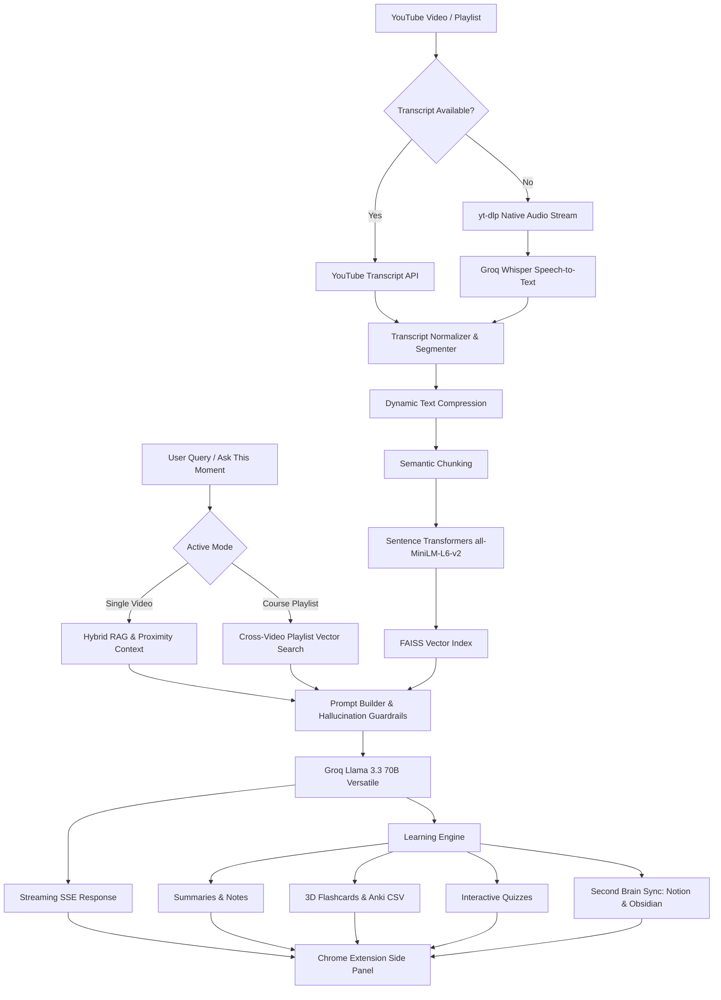

<p align="center">
  
</p>

<h1 align="center">🧠 TubeMind AI</h1>
<h3 align="center">AI-Powered YouTube Learning Assistant & Second Brain</h3>

<p align="center">
  Hybrid RAG • Multi-Video Playlist RAG • Groq Whisper Fallback • Flashcards & Quizzes • Notion & Obsidian Sync • FAISS • Multilingual AI
</p>

<p align="center">
  
  
  
  
  
</p>

---

# 🚀 Overview

**TubeMind AI** is a state-of-the-art Chrome Extension and FastAPI backend that transforms YouTube into an active, multi-modal learning workspace.

Instead of passively watching lectures or wrestling with missing transcripts, TubeMind AI pairs **Hybrid Transcript Retrieval & Groq Whisper Fallback**, **Course-Level FAISS Vector Search**, **Dynamic Playback Synchronization**, **Interactive 3D Study Flashcards & Quizzes**, and **Direct Second Brain Sync (Notion & Obsidian)** to supercharge comprehension and long-term retention.

---

# 🎯 Key Highlights

- 🎙️ **Groq Whisper Audio Fallback**: Zero "No transcript available" errors. When YouTube captions or auto-generated transcripts are disabled, TubeMind automatically extracts native audio streams using `yt-dlp` and transcribes with Groq Whisper.
- 🗂️ **Interactive Study Flashcards**: AI-generated active recall flashcards with interactive 3D flip cards, mastery counters, and 1-click **Anki (.csv)** deck export.
- 📝 **Interactive Quiz Mode**: Auto-generated multiple-choice questions with real-time scoring, detailed explanations, and clickable video timestamp seeking.
- 🎯 **"Ask About This Moment" Proximity Q&A**: Real-time video player synchronization. With a single click, TubeMind extracts the exact ±90s surrounding scene context and answers queries grounded in the current visual moment.
- 🧠 **Second Brain Direct Sync (Notion & Obsidian)**:
  - **Notion Direct Integration**: 1-click sync to Notion databases or pages with formatted headings, toggle callouts, and bulleted takeaways.
  - **Obsidian Direct Export**: Exports `.md` files with YAML frontmatter, native Obsidian callout blocks (`> [!tip]`), and opens directly in Obsidian via `obsidian://` protocol.
- 📚 **Multi-Video / Course-Level Playlist RAG**: Detects YouTube playlists, indexes up to 20 lectures into a unified FAISS vector store, and enables cross-lecture AI tutoring with exact video title and timestamp citations.
- 🌍 **Multilingual AI (14+ Languages)**: AI translations across summaries, study notes, takeaways, interview questions, flashcards, and quizzes.
- ⚡ **Hybrid RAG & Semantic Retrieval**: Sentence Transformers (`all-MiniLM-L6-v2`) + FAISS Inner Product cosine similarity + dynamic context compression for sub-second, hallucination-resistant answers.

---

# ✨ Features

## 🤖 AI Chat & Scene-Aware Q&A
- Multi-turn conversation memory with sliding token budgeting
- Real-time streaming responses via Server-Sent Events (SSE)
- Clickable timestamp citations that jump directly to the exact second in the YouTube video
- 🎯 **"Ask About This Moment"**: Injects ±90s proximity context of what you are currently watching
- Copy to clipboard & one-click regeneration

## 📚 AI Learning & Second Brain
- **Executive Summaries**: Short, Detailed, and Bullet summaries
- **Comprehensive Study Notes**: Key concepts, definitions, and architectures
- **Actionable Takeaways**: Quick-hit summaries of the most impactful learnings
- **Technical Interview Prep**: Video-grounded technical Q&As with Easy, Medium, and Hard ratings
- **🗂️ Interactive Study Flashcards**: 3D flip card animations, category tags, mastery tracking, and Anki CSV download
- **📝 Interactive Quiz Mode**: Test your understanding with multiple-choice questions, instant score calculation, and timestamp jump buttons
- **🧠 Direct Sync**: Push generated notes, takeaways, and summaries directly to Notion or Obsidian in one click

## 📚 Course-Level Playlist RAG
- Automatically detects YouTube course playlists and series
- 1-Click indexes all playlist video transcripts into a unified multi-video vector store
- Dedicated **Course Mode** tab in the side panel
- Ask cross-video questions (e.g., *"Which lecture covered backpropagation and how does it compare to gradient descent?"*) with lecture-level citations

## 🌍 Multilingual AI (14+ Languages)
Supports automatic language detection and native translation into:
- **English**, **Hindi**, **Marathi**, **Tamil**, **Telugu**, **Kannada**, **Gujarati**, **Punjabi**
- **Spanish**, **French**, **German**, **Japanese**, **Korean**, **Chinese**

## 📤 Multi-Format Export
Export all learning content as:
- 📄 **PDF** (Styled formatting)
- 📝 **Microsoft Word** (`.docx`)
- 📋 **Markdown** (`.md`)
- 📦 **Complete Bundle** (`.zip`)
- 📓 **Notion Database/Page Sync**
- 🪨 **Obsidian Vault File** (`obsidian://` protocol)
- 🗂️ **Anki Deck** (`.csv`)

---

# 🏗️ Architecture



---

# 🛠️ Tech Stack

<p align="center">
  
</p>

### Frontend (Chrome Extension)
- **Framework**: React 18, TypeScript, Vite
- **Styling**: Tailwind CSS, Lucide React Icons, Radix UI Primitives
- **State Management**: Zustand
- **Architecture**: Chrome Extension Manifest V3 (Side Panel, Content Script, Background Worker)

### Backend & AI Stack
- **Web API**: FastAPI, Uvicorn, Pydantic v2
- **LLM Orchestration**: Groq Cloud API (`llama-3.3-70b-versatile`, `llama-3.1-8b-instant`, `openai/gpt-oss-120b`)
- **Speech-to-Text Fallback**: Groq Whisper Large v3 + yt-dlp native audio extraction
- **Vector Database**: FAISS (Facebook AI Similarity Search) with Inner Product cosine similarity
- **Embeddings**: HuggingFace Sentence Transformers (`sentence-transformers/all-MiniLM-L6-v2`)
- **Second Brain Integrations**: Notion REST API & Obsidian URI Protocol

---

# ⚙️ Installation & Setup

### 1. Clone Repository
```bash
git clone https://github.com/Omkar-narsale/TubeMind-AI.git
cd TubeMind-AI
```

---

### 2. Backend Setup

```bash
cd backend

# Create and activate virtual environment
python -m venv venv
# Windows:
.\venv\Scripts\activate
# Linux/macOS:
source venv/bin/activate

# Install dependencies
pip install -r requirements.txt
```

Create a `.env` file in the `backend/` directory:
```env
# Groq API Configuration (Required)
GROQ_API_KEY=your_groq_api_key_here
GROQ_MODEL=llama-3.3-70b-versatile

# Notion Integration (Optional - can also be configured in extension settings)
NOTION_API_KEY=your_notion_api_key_here
NOTION_DATABASE_ID=your_notion_database_id_here
```

Start the FastAPI server:
```bash
python -m uvicorn app.main:app --reload --port 8000
```
*API documentation will be available at `http://localhost:8000/docs`.*

---

### 3. Chrome Extension Setup

```bash
cd extension

# Install dependencies
npm install

# Build the production bundle
npm run build
```

1. Open Google Chrome and navigate to:
   ```text
   chrome://extensions/
   ```
2. Toggle on **Developer Mode** in the top-right corner.
3. Click **Load unpacked**.
4. Select the `extension/dist` folder.

---

# 📖 Usage Guide

1. **Open YouTube**: Navigate to any educational video, lecture, or tutorial on YouTube.
2. **Launch TubeMind**: Click the TubeMind AI icon or open the Chrome Side Panel.
3. **Ask About This Moment**: As the video plays, click the **🎯 Moment** button to instantly query concepts explained in the scene currently on screen.
4. **Interactive Flashcards**: Switch to the **Cards** tab to practice with 3D flip flashcards, track mastered cards, and export to Anki.
5. **Test Your Knowledge**: Switch to the **Quiz** tab to take auto-generated multiple-choice quizzes with real-time feedback.
6. **Sync to Notion / Obsidian**: Click **Export** in the top bar to push full notes and takeaways straight into your Notion workspace or open them as formatted notes in Obsidian.
7. **Course Mode**: On any video inside a playlist, toggle to **Course Mode** to index all lectures and ask questions across the entire curriculum.

---

# 🧪 Testing

Run the full automated test suite (50+ unit and integration tests):

```bash
cd backend
python -m pytest
```

---

# 🛣️ Roadmap

- [x] Chrome Extension Side Panel with MV3
- [x] Hybrid RAG Pipeline & Semantic FAISS Search
- [x] Real-time Streaming SSE Chat
- [x] Multilingual Translation (14+ Languages)
- [x] Multi-Format Document Export (PDF, DOCX, Markdown, ZIP)
- [x] Groq Whisper Audio Fallback for videos without transcripts
- [x] Interactive 3D Flashcards with Anki Export
- [x] Interactive Quiz Mode with Video Timestamp Seek
- [x] "Ask About This Moment" Proximity Scene Q&A
- [x] Direct Second Brain Sync (Notion & Obsidian)
- [x] Multi-Video / Course-Level Playlist RAG
- [ ] User Personal Groq API Key Input in UI
- [ ] Chrome Web Store Release
- [ ] Cloud-Synced Bookmark & Learning History Vault

---

# 🤝 Contributing

Contributions are warmly welcomed! Please follow these steps:

1. Fork the Project
2. Create your Feature Branch (`git checkout -b feature/AmazingFeature`)
3. Commit your Changes (`git commit -m 'feat: Add AmazingFeature'`)
4. Push to the Branch (`git push origin feature/AmazingFeature`)
5. Open a Pull Request

---

# 📄 License

Distributed under the MIT License. See `LICENSE` for more information.

---

# 👨‍💻 Author

**Omkar Narsale**
- GitHub: [@Omkar-narsale](https://github.com/Omkar-narsale)
- LinkedIn: [omkar-narsale45](https://www.linkedin.com/in/omkar-narsale45)

---

<p align="center">
  Made with ❤️ using React, TypeScript, FastAPI, FAISS, and Groq.
</p>
