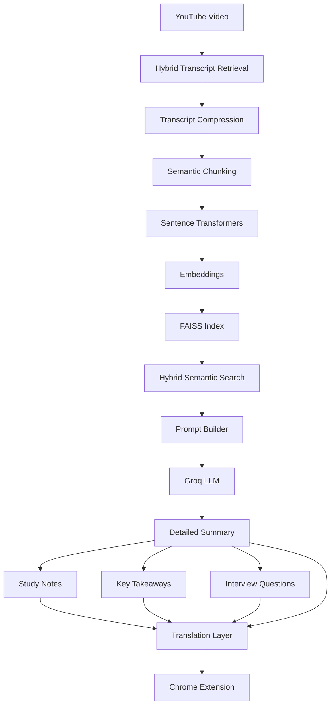

<p align="center">
  
</p>

<h1 align="center">🧠 TubeMind AI</h1>
<h3 align="center">AI-Powered YouTube Learning Assistant</h3>

<p align="center">
  Hybrid RAG • Semantic Search • FAISS • Groq • Chrome Extension • Multilingual AI
</p>

<p align="center">
  
  
  
  
</p>

---

# 🚀 Overview

TubeMind AI is an AI-powered Chrome Extension that transforms YouTube videos into an interactive learning experience.

Using **Hybrid Transcript Retrieval**, **Retrieval-Augmented Generation (RAG)**, **Semantic Search**, **FAISS Vector Search**, **Groq LLMs**, and **Multilingual AI Translation**, TubeMind AI enables users to:

- 💬 Chat with YouTube videos
- 📄 Generate AI summaries
- 📝 Create structured study notes
- 💡 Review key takeaways
- 💼 Generate interview questions
- 🌍 Translate AI responses into multiple languages
- 📍 Jump to timestamp citations
- 📤 Export learning content
- 🧠 Learn faster with AI

---

# 🎯 Key Highlights

- 🧠 Hybrid Retrieval-Augmented Generation (Hybrid RAG)
- 🔎 FAISS-based Semantic Search
- 🌍 Multilingual AI Translation (14+ Languages)
- 🎥 Hybrid Transcript Retrieval
- 💬 AI Chat with YouTube Videos
- 📄 AI-Powered Learning Content Generation
- 💼 AI Interview Question Generator
- 📍 Timestamp-Based Context Retrieval
- 📤 Export to PDF, DOCX & Markdown
- ⚡ Chrome Extension powered by FastAPI & Groq LLMs

---

# ✨ Features

## 🤖 AI Chat

- Multi-turn conversation memory
- Streaming AI responses
- Timestamp citations
- Markdown rendering
- Retry responses
- Copy responses

---

## 📚 AI Learning

- Short Summary
- Detailed Summary
- Bullet Summary
- Study Notes
- Key Takeaways
- Interview Questions

---

## 🌍 Multilingual AI

- Automatic language detection
- Hybrid transcript retrieval
- AI-powered translation
- English
- Hindi
- Marathi
- Tamil
- Telugu
- Kannada
- Gujarati
- Punjabi
- Spanish
- French
- German
- Japanese
- Korean
- Chinese

Supports translation for:

- Summary
- Study Notes
- Key Takeaways
- Interview Questions

---

## 📤 Export Learning Content

Export generated learning content as:

- 📄 PDF
- 📝 Microsoft Word (.docx)
- 📋 Markdown (.md)

Supports exporting:

- Summary
- Study Notes
- Key Takeaways
- Interview Questions

---

## 🧠 Hybrid RAG Pipeline

- Hybrid Transcript Retrieval
- Transcript Compression
- Semantic Chunking
- Sentence Transformers
- Embedding Generation
- FAISS Vector Search
- Hybrid Semantic Search
- Context Compression
- Prompt Engineering
- AI Translation Layer

---

# 🛠️ Tech Stack

<p align="center">
  
</p>

## Frontend

- React
- TypeScript
- Tailwind CSS
- Vite
- Chrome Extension APIs

---

## Backend

- FastAPI
- Python
- Uvicorn

---

## AI Stack

- Groq
- Llama 3.3 70B
- Llama 3.1 8B Instant
- Sentence Transformers
- FAISS
- Hybrid Transcript Retrieval
- Retrieval-Augmented Generation (RAG)
- Semantic Search
- Prompt Engineering
- AI Translation Pipeline

---

# 🏗️ Architecture



---

# 📂 Project Structure

```text
TubeMind-AI
│
├── assets
│   ├── banner.png
│   ├── demo.gif
│   ├── chat.png
│   ├── summary.png
│   ├── notes.png
│   ├── takeaways.png
│   ├── interview.png
│   └── translation.png
│
├── backend
│
├── extension
│
├── README.md
│
└── .gitignore
```

---

# ⚙️ Installation

## Clone Repository

```bash
git clone https://github.com/Omkar-narsale/TubeMind-AI.git

cd TubeMind-AI
```

---

## Backend Setup

```bash
cd backend

pip install -r requirements.txt
```

Create a `.env` file:

```env
GROQ_API_KEY=YOUR_API_KEY

GROQ_MODEL=llama-3.3-70b-versatile
```

Run the backend:

```bash
uvicorn app.main:app --reload
```

---

## Chrome Extension Setup

```bash
cd extension

npm install

npm run build
```

Open:

```
chrome://extensions
```

Enable **Developer Mode**

Click:

**Load unpacked**

Select:

```
extension/dist
```

---

# 📖 Usage

1. Open any YouTube video.
2. Launch TubeMind AI.
3. Wait for Hybrid Transcript Processing.
4. Chat with the video.
5. Generate AI Summary.
6. Create Study Notes.
7. Review Key Takeaways.
8. Generate Interview Questions.
9. Translate content into your preferred language.
10. Export learning content as PDF, DOCX or Markdown.

---

# 🌍 Supported Languages

- Auto
- English
- Hindi
- Marathi
- Tamil
- Telugu
- Kannada
- Gujarati
- Punjabi
- Spanish
- French
- German
- Japanese
- Korean
- Chinese

---

# 📤 Export Formats

TubeMind AI supports exporting generated learning content in:

- PDF (.pdf)
- Microsoft Word (.docx)
- Markdown (.md)

Available for:

- Summary
- Study Notes
- Key Takeaways
- Interview Questions

---

# 🛣️ Roadmap

## ✅ Completed

- Chrome Extension
- FastAPI Backend
- Hybrid Transcript Retrieval
- Transcript Compression
- Semantic Chunking
- Context Compression
- Sentence Transformers
- Embedding Generation
- FAISS Vector Database
- Hybrid Semantic Search
- Hybrid RAG Pipeline
- Groq Integration
- Streaming Chat
- Conversation Memory
- Timestamp Citations
- AI Summary
- Study Notes
- Key Takeaways
- Interview Questions
- Multilingual AI Translation
- Export to PDF
- Export to DOCX
- Export to Markdown

---

## 🚧 Coming Soon

- Learning Dashboard
- User API Key Support
- Bookmark & Saved Sessions
- Chrome Web Store Release
- Cloud Sync

---

# 🤝 Contributing

Contributions are welcome!

```bash
git checkout -b feature/my-feature

git commit -m "Add amazing feature"

git push origin feature/my-feature
```

Open a Pull Request.

---

# 📄 License

Licensed under the MIT License.

---

# 👨‍💻 Author

**Omkar Narsale**

- GitHub: https://github.com/Omkar-narsale
- LinkedIn: https://www.linkedin.com/in/omkar-narsale45

---

# ⭐ Support

If you found this project useful, please give it a ⭐ on GitHub.

It helps others discover the project and supports future development.

---

<p align="center">
Made with ❤️ using React, FastAPI, Hybrid RAG, FAISS and Groq.
</p>
