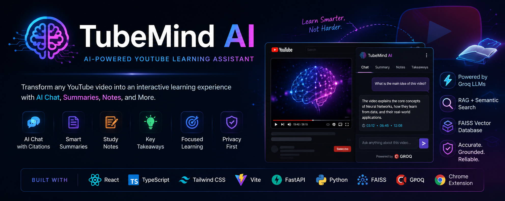
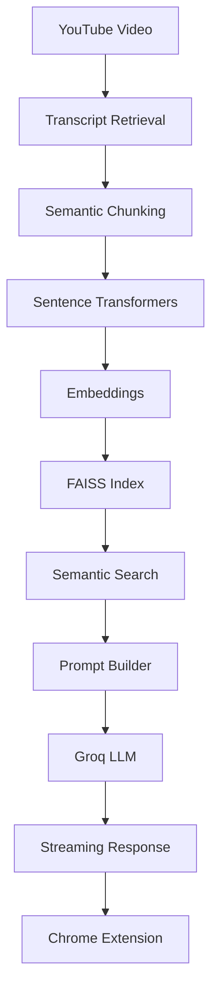

<p align="center">
  
</p>

<h1 align="center">🧠 TubeMind AI</h1>
<h3 align="center">AI-Powered YouTube Learning Assistant</h3>

<p align="center">
  Retrieval-Augmented Generation • Semantic Search • FAISS • Groq • Chrome Extension
</p>

<p align="center">
  
  
  
  
</p>

---

## 🚀 Overview

TubeMind AI is an AI-powered Chrome Extension that transforms YouTube videos into an interactive learning experience.

Using Retrieval-Augmented Generation (RAG), semantic search, FAISS vector search, and Groq LLMs, TubeMind AI enables users to:

- 💬 Chat with YouTube videos
- 📄 Generate AI summaries
- 📝 Create structured study notes
- 💡 Review key takeaways
- 📍 Jump to timestamp citations
- 🧠 Learn faster with AI

---

## ✨ Features

### 🤖 AI Chat
- Multi-turn conversation memory
- Streaming AI responses
- Timestamp citations
- Markdown rendering
- Retry & Copy responses

### 📚 AI Learning
- Short Summary
- Detailed Summary
- Bullet Summary
- Study Notes
- Key Takeaways

### 🧠 RAG Pipeline
- Transcript Retrieval
- Semantic Chunking
- Sentence Transformers
- FAISS Vector Search
- Semantic Retrieval
- Prompt Engineering

---

## 🖼️ Screenshots

> Add your screenshots to the `assets/` folder.

| Chat | Summary |
|------|---------|
|  |  |

| Study Notes | Takeaways |
|-------------|-----------|
|  |  |

---

## 🎥 Demo

<p align="center">
  
</p>

---

## 🛠️ Tech Stack

<p align="center">
  
</p>

### AI Stack
- Groq
- Llama 3.3 70B
- Sentence Transformers
- FAISS
- Retrieval-Augmented Generation (RAG)
- Prompt Engineering

---

## 🏗️ Architecture



---

## 📂 Project Structure

```text
TubeMind-AI
│
├── assets
│   ├── banner.png
│   ├── demo.gif
│   ├── chat.png
│   ├── summary.png
│   ├── notes.png
│   └── takeaways.png
│
├── backend
├── extension
├── README.md
└── .gitignore
```

---

## ⚙️ Installation

### Clone

```bash
git clone https://github.com/Omkar-narsale/TubeMind-AI.git
cd TubeMind-AI
```

### Backend

```bash
cd backend
pip install -r requirements.txt
```

Create a `.env`

```env
GROQ_API_KEY=YOUR_API_KEY
GROQ_MODEL=llama-3.3-70b-versatile
```

Run

```bash
uvicorn app.main:app --reload
```

### Extension

```bash
cd extension
npm install
npm run build
```

Load the generated `extension/dist` folder from `chrome://extensions` using **Load unpacked**.

---

## 📖 Usage

1. Open any YouTube video.
2. Launch TubeMind AI.
3. Wait for transcript processing.
4. Chat with the video.
5. Generate summaries.
6. Generate study notes.
7. Review key takeaways.

---

## 🛣️ Roadmap

### ✅ Completed
- Chrome Extension
- FastAPI Backend
- Transcript Retrieval
- Semantic Search
- FAISS
- RAG
- Groq Integration
- Streaming Chat
- Conversation Memory
- Timestamp Citations
- AI Summary
- Study Notes
- Key Takeaways

### 🚧 Coming Soon
- Hybrid RAG
- Flashcards
- Quiz Generator
- Practice Questions
- PDF Export
- Bookmarks
- Learning Dashboard
- User API Key Support
- Chrome Web Store Release

---

## 🤝 Contributing

Contributions are welcome!

```bash
git checkout -b feature/my-feature
git commit -m "Add amazing feature"
git push origin feature/my-feature
```

Open a Pull Request.

---

## 📄 License

Licensed under the MIT License.

---

## 👨‍💻 Author

**Omkar Narsale**

- GitHub: https://github.com/Omkar-narsale
- LinkedIn: www.linkedin.com/in/omkar-narsale45

---

## ⭐ Support

If you found this project useful, please give it a ⭐ on GitHub.

<p align="center">
  Made with ❤️ using React, FastAPI, FAISS and Groq.
</p>
